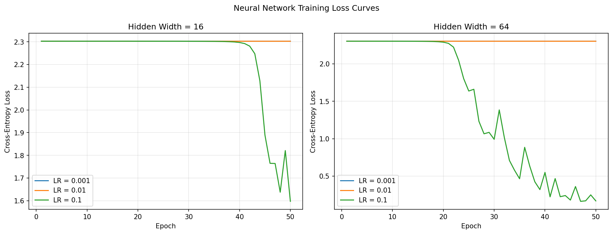
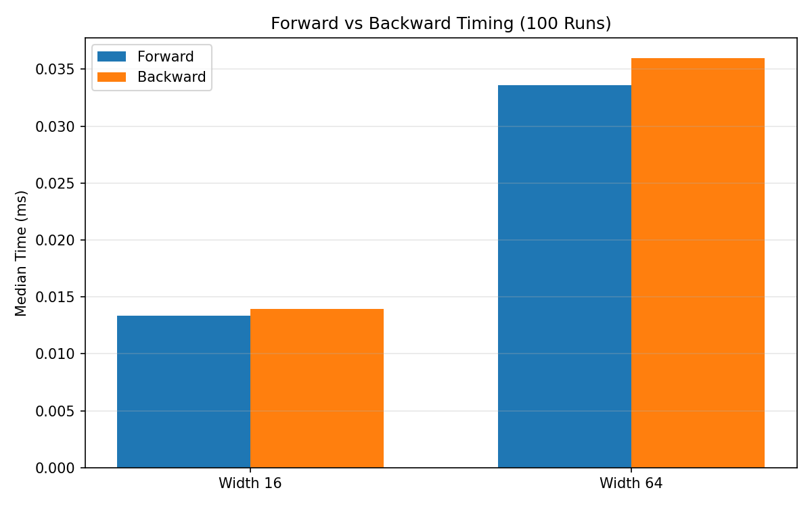

# Lab 2: A Neural Network from Scratch

## Goal

The goal of this lab was to implement a two-hidden-layer neural network from scratch with NumPy, validate its analytical gradients numerically, and compare how hidden-layer width and learning rate affect classification accuracy, training loss, and computation time on the scikit-learn digits dataset.

## Method

The `load_digits` dataset contains 1,797 handwritten digit images represented by 64 pixel values. Inputs were converted to `float64` and divided by 16 so that every feature lies in the range `[0, 1]`. Labels were one-hot encoded. The data were divided into 70% training and 30% test sets using a stratified split with `random_state=42`, producing 1,257 training samples and 540 test samples.

The network has an input layer of 64 units, two equally sized hidden layers with ReLU activation, and a 10-unit softmax output layer. Hidden widths of 16 and 64 were tested. The three weight matrices have shapes `(64, W)`, `(W, W)`, and `(W, 10)`; the corresponding bias vectors have shapes `(W,)`, `(W,)`, and `(10,)`. Weights were sampled from a normal distribution with standard deviation 0.01 and biases were initialized to zero.

Cross-entropy was used as the loss function. The untrained network produced a loss of 2.302583, which agrees with the expected value `ln(10) = 2.302585`. Analytical gradients were derived with the chain rule and checked using central differences with perturbations of `+/-1e-5`. All 10 sampled weights passed the required relative-error threshold of `1e-6`.

Each configuration was trained for 50 epochs with shuffled mini-batches of 32 samples. The tested learning rates were 0.001, 0.01, and 0.1. Random generators were seeded with 42. Final accuracy was measured only on the test split.

Forward and backward propagation were timed separately on batches of 32 samples. Each measurement used 10 warm-up iterations followed by 100 timed runs, and the median was reported. The experiment used Python 3.11.8 and the package versions recorded in `results/versions.txt`.

## Results

### Gradient check

| Check | Result |
|---|---:|
| Sampled weights | 10 |
| Relative-error requirement | `< 1e-6` |
| Passed weights | 10/10 |
| Overall result | PASS |

The largest reported relative error was `4.11e-7`, below the required threshold.

### Final test accuracy

| Hidden width | Learning rate | Final test accuracy |
|---:|---:|---:|
| 16 | 0.001 | 10.19% |
| 16 | 0.01 | 10.19% |
| 16 | 0.1 | 32.59% |
| 64 | 0.001 | 10.19% |
| 64 | 0.01 | 10.19% |
| 64 | 0.1 | **93.89%** |

The best configuration used hidden width 64 and learning rate 0.1. The two smaller learning rates remained close to random-guess accuracy during the required 50 epochs because the small initial weights produced small gradients and correspondingly slow parameter updates.

### Loss curves

The loss curves show that learning rate 0.1 was the only tested rate that produced substantial learning within 50 epochs. Width 64 converged much more effectively than width 16 at that rate. The visible fluctuations at the higher learning rate are consistent with mini-batch gradient updates.

### Forward and backward timing

| Hidden width | Forward median (ms) | Backward median (ms) | Slower pass |
|---:|---:|---:|---|
| 16 | 0.0134 | 0.0140 | Backward |
| 64 | 0.0336 | 0.0360 | Backward |

Backward propagation was slightly slower for both widths because it performs additional matrix multiplications to propagate derivatives and compute gradients for every weight matrix and bias vector. Increasing the hidden width from 16 to 64 increased both timings because the hidden-layer matrix multiplication grew from a `16 x 16` operation to a `64 x 64` operation.

## Conclusions

1. Learning rate had the strongest effect in the required 50-epoch budget: rates of 0.001 and 0.01 barely changed the initial loss, while 0.1 allowed the network to learn useful digit representations.
2. The wider network used its additional capacity effectively, reaching 93.89% test accuracy at width 64 and learning rate 0.1, compared with 32.59% for width 16 at the same learning rate.
3. Backpropagation was consistently slower than forward propagation, and both passes became more expensive as hidden width increased because their matrix multiplications involved more elements.
