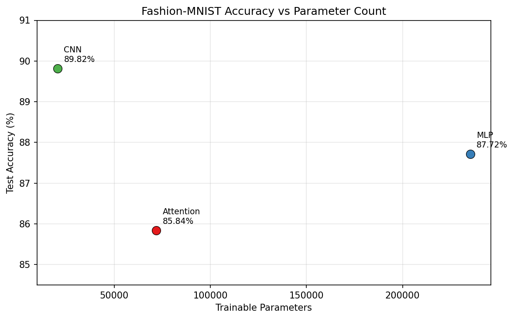
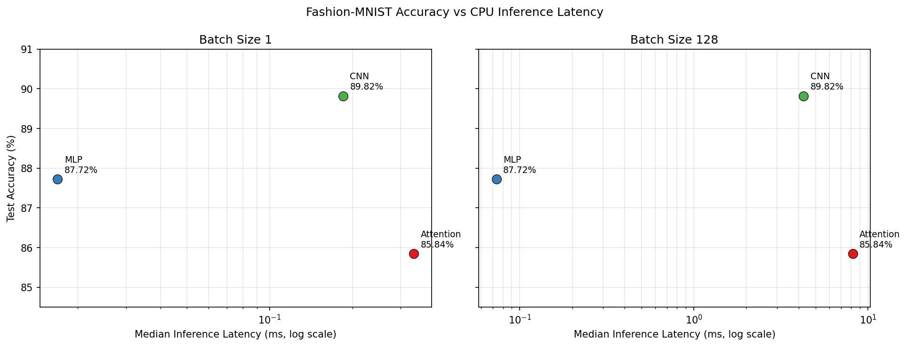

# Lab 3: Architectures and Their Costs

## Goal

The goal of this lab was to implement and compare an MLP, a CNN, and a patch-based attention classifier on Fashion-MNIST. The comparison considers test accuracy, parameter count, representative floating-point operations, and CPU inference latency so that architectural efficiency is evaluated rather than accuracy alone.

## Method

### Dataset and split

Fashion-MNIST was loaded with `torchvision.datasets.FashionMNIST`. Images were converted to tensors and normalized with mean 0.2860 and standard deviation 0.3530. The official 60,000-image training set was divided reproducibly into 55,000 training and 5,000 validation images with a generator seeded at 42. The official 10,000-image test set was kept separate until training was complete. All training data loaders used batch size 128.

### Architectures

The MLP flattens each 28 x 28 image and applies linear layers of 784 -> 256 -> 128 -> 10 with ReLU between the hidden layers. The CNN applies a 3 x 3 convolution from 1 to 16 channels, 2 x 2 max pooling, a second 3 x 3 convolution from 16 to 32 channels, another max-pooling operation, and a final linear classifier from 32 x 7 x 7 features to 10 classes.

The attention model divides each image into 16 non-overlapping 7 x 7 patches. Each 49-value patch is projected to 64 dimensions and processed by two Transformer encoder layers with `d_model=64`, four attention heads, and a feedforward dimension of 128. A learned positional embedding was added so that the encoder can distinguish the spatial locations of otherwise unordered patch tokens. Mean pooling over the 16 encoded tokens is followed by a 64 -> 10 classifier.

The manual describes the models as similarly sized with a target of 100,000-150,000 parameters, but the exact architectures specified by the same manual do not satisfy that range. The prescribed layer dimensions were retained rather than silently changing the assignment: the resulting counts are 235,146 for the MLP, 20,490 for the CNN, and 71,818 for the attention model including its positional embedding.

### Training protocol

All models used cross-entropy loss and Adam with learning rate `1e-3`. Each model was trained for five epochs on CPU using the same split and deterministic shuffle seed. Training and validation loss and accuracy were recorded after every epoch. Test loss and accuracy were calculated once after each model's five training epochs.

### FLOPs and parameter measurement

Parameters were counted with `torchinfo.summary`. Representative FLOPs were calculated using the Chapter 4 convention that counts a multiplication and addition as two operations:

- Linear: `2 x input features x output features`
- Conv2d: `2 x K x K x input channels x output channels x output height x output width`
- Attention: QKV projections, attention-score products, weighted-value products, output projection, and both feedforward projections

The first MLP linear layer requires `2 x 784 x 256 = 401,408` FLOPs. The first CNN convolution requires `2 x 3 x 3 x 1 x 16 x 28 x 28 = 225,792` FLOPs. One attention encoder layer requires approximately 1,114,112 FLOPs under the stated counting convention.

The models were also profiled with `thop.profile`. THOP reports multiply-accumulate operations (MACs), so twice the reported MAC count matches the hand calculation for supported MLP and CNN operations. THOP does not profile PyTorch `TransformerEncoder` internals by default; its attention result therefore includes only the patch projection and final classifier and must not be interpreted as the complete attention-model cost.

### Latency protocol

Inference latency was measured on CPU with each model in evaluation mode and inside `torch.inference_mode()`. Each case used 10 warm-up runs. Batch size 1 was measured 100 times and batch size 128 was measured 20 times. Median wall-clock latency is reported because it is less sensitive to operating-system interruptions than a single measurement or the mean.

## Results

### Parameter count and compute cost

| Model | Parameters (`torchinfo`) | Hand-calculated FLOPs | THOP MACs | `2 x` THOP MACs |
|---|---:|---:|---:|---:|
| MLP | 235,146 | 469,504 | 234,752 | 469,504 |
| CNN | 20,490 | 2,063,488 | 1,031,744 | 2,063,488 |
| Attention | 71,818 | 2,329,856 | 50,816 | 101,632 |

The MLP and CNN show exact agreement between the representative hand count and twice THOP's MAC count. The attention gap is caused by unsupported Transformer encoder internals, as confirmed by THOP also reporting only 3,850 of the model's 71,818 parameters.

### Accuracy

| Model | Epoch 5 validation accuracy | Test accuracy | Test loss | Training time (s) |
|---|---:|---:|---:|---:|
| MLP | 88.18% | 87.72% | 0.3425 | 11.63 |
| CNN | **90.00%** | **89.82%** | **0.2842** | 61.59 |
| Attention | 85.78% | 85.84% | 0.4010 | 74.09 |

### CPU inference latency

| Model | Batch 1 median (ms) | Batch 128 median (ms) |
|---|---:|---:|
| MLP | **0.0169** | **0.0733** |
| CNN | 0.1849 | 4.2620 |
| Attention | 0.3351 | 8.1739 |

### Accuracy and parameter trade-off

The CNN achieved the highest accuracy despite having fewer than one tenth as many parameters as the MLP. Convolutional weight sharing gives the CNN a strong spatial inductive bias and reuses the same small kernels across the image. This substantially reduces parameter storage while still extracting local edges and shapes that are useful for clothing recognition.

### Accuracy and latency trade-off

## Architecture Trade-offs and Access Patterns

The MLP consists mainly of dense matrix multiplications. These operations map efficiently to contiguous, highly optimized matrix kernels, which explains its very low latency. However, flattening discards the two-dimensional structure of the image, and the first dense layer creates most of the model's 235,146 parameters. It is the best choice when extremely low CPU latency is more important than the final two percentage points of accuracy.

The CNN repeatedly accesses small local neighborhoods and reuses each convolution kernel across all spatial positions. This regular access pattern provides high data reuse and keeps the parameter count low. Its convolutional operations perform more arithmetic than the MLP and therefore increase latency, but the locality and weight sharing produce the highest accuracy. For this experiment, the CNN offers the best overall balance of accuracy and model size.

The attention model projects patches and then performs multiple dense projections plus all-to-all token interactions. Attention-score storage and computation scale quadratically with sequence length, while the projections and feedforward blocks move and transform every token repeatedly. With only 16 tokens this quadratic term is still small, but the many separate Transformer operations produce the highest measured latency. Five epochs on this relatively small image task were also insufficient for attention to overcome the CNN's useful spatial bias.

## Conclusions

1. The CNN was the most cost-effective architecture in this experiment: it achieved the highest test accuracy, 89.82%, with only 20,490 parameters because convolutional weight sharing exploits image locality efficiently.
2. Parameter count alone did not predict runtime: the MLP had the most parameters but the lowest latency, while the attention model had fewer parameters yet the highest latency because operation type, activation movement, and access patterns also determine system cost.
3. Profiling-tool output must be interpreted against the tool's supported operations and counting convention; THOP matched the hand calculations for MLP and CNN after converting MACs to FLOPs but substantially undercounted the Transformer encoder.

## Supplementary Paper Work

The manual parameter calculations and representative Linear, Conv2d, and Attention FLOPs calculations are collected in [`paper_work.md`](paper_work.md) for handwritten submission.
